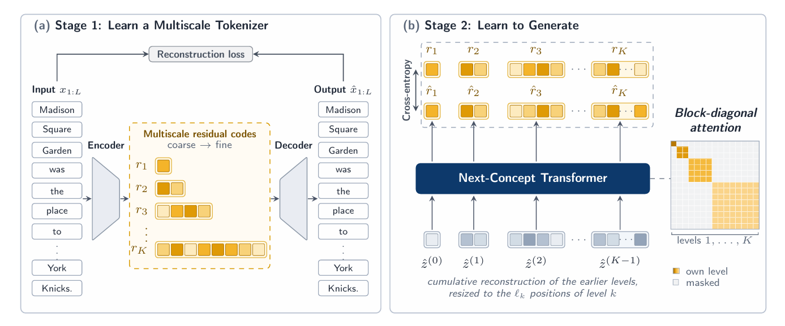

**Next Concept Modeling (NCM)**, a novel research method from Stanford's Hazy Research team that seeks to improve text generation efficiency (0:23-0:31).
 [Next-Concept-Modeling](https://arxiv.org/pdf/2610.14162)

**Key takeaways include:**

*   **The Generation Problem:** Traditional Large Language Models (LLMs) use **autoregressive generation**, meaning they must predict tokens one-by-one, which creates a sequential bottleneck (1:05-1:46).
*   **NCM's Approach:** Instead of word-by-word generation, NCM uses a **coarse-to-fine** process. It first sketches a rough representation of the entire sequence using discrete codes in a hierarchy and then fills in finer details in parallel across levels (2:25-3:22, 4:46-5:07).
*   **Performance Results:** On the *XSum* summarization benchmark, NCM demonstrated **comparable quality** to diffusion language model baselines while running up to **31 times faster** in the authors' specific experimental setup (6:23-6:49).
*   **Important Nuance:** NCM is a research system, not a direct replacement for current general-purpose LLMs like *ChatGPT* (0:43-0:55, 12:26-13:06). It remains an **alternative generation strategy** that still relies on transformers (12:30-12:41).
*   **Practical Lessons:** advise speed-up claims are benchmark-specific, and developers should conduct **independent testing** on their specific hardware and workloads to evaluate NCM's efficacy (13:08-14:02).

# algorithm 

### 1. Multiscale Tokenizer (Training)

This component is responsible for encoding and reconstructing text through a hierarchy of discrete codes (4:18-4:31).

*   **Input:** Raw text sequence.
*   **Process:** Uses a **multiscale residual VQ-VAE** (Vector Quantized Variational Autoencoder) to map text into a hierarchy of $L$ levels.
*   **Output:** A stack of discrete codes where early levels provide a coarse representation and later levels add finer details.
*   **Objective:** Ensure the decoder can reconstruct the original text accurately from the final stack of codes.

### 2. Transformer Generator (Inference)

Once the tokenizer is trained and **frozen**, the generator is trained to predict the hierarchy of codes (4:38-4:54).

*   **Process:** The transformer generates levels in sequence, from coarse to fine.
*   **Parallelism:** For each level, the generator predicts all discrete codes at that level in **parallel**, conditioned on the information from all preceding levels.
*   **Decoding:** Finally, the frozen tokenizer’s decoder takes the completed hierarchical code structure and reconstructs it back into the final text sequence.

In essence, while standard autoregressive models use a loop to predict the next token (1:05-1:46), NCM replaces that loop with a series of parallel transformer passes, each generating a complete, increasingly detailed level of the final output (4:46-5:07).